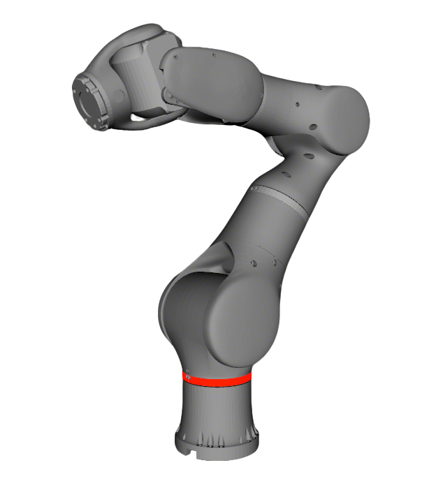

# Rokae AR5-CCS Description

This package contains both Rokae AR5 CCS generations:

- `variant:=base_ar5_ccs`: original CCS
- `variant:=base_ar5_ccs_v2`: second-generation CCS

Supported `type` values (see `xacro/robot.xacro`): `left`, `right`, `left_rg75`, `right_rg75`, `rg75`. Omit `type` for dual arms without end effector; use `rg75` for dual arms with RG75 grippers.

## 1. Build

```bash
cd ~/ros2_ws
colcon build --packages-up-to ar5_ccs_description --symlink-install
```

Pass `variant:=base_ar5_ccs_v2` to any command below to select CCS V2. Omitting
`arm` selects the original `ar5_ccs`.

## 2. Visualize the robot

### 2.1 CCS arm without end effector

* Left arm
    ```bash
    source ~/ros2_ws/install/setup.bash
    ros2 launch robot_common_launch manipulator.launch.py robot:=ar5_ccs type:=left collider:=simple
    ```
  
* Right arm
    ```bash
    source ~/ros2_ws/install/setup.bash
    ros2 launch robot_common_launch manipulator.launch.py robot:=ar5_ccs type:=right collider:=simple
    ```
* Dual arms
    ```bash
    source ~/ros2_ws/install/setup.bash
    ros2 launch robot_common_launch manipulator.launch.py robot:=ar5_ccs collider:=simple
    ```

### 2.2 CCS arm with Jodell RG75

* Left arm
    ```bash
    source ~/ros2_ws/install/setup.bash
    ros2 launch robot_common_launch manipulator.launch.py robot:=ar5_ccs type:=left_rg75 collider:=simple
    ```
* Right arm
    ```bash
    source ~/ros2_ws/install/setup.bash
    ros2 launch robot_common_launch manipulator.launch.py robot:=ar5_ccs type:=right_rg75 collider:=simple
    ```
* Dual arms
    ```bash
    source ~/ros2_ws/install/setup.bash
    ros2 launch robot_common_launch manipulator.launch.py robot:=ar5_ccs type:=rg75 collider:=simple
    ```

## 3. OCS2 Demo

### 3.1 Official OCS2 mobile manipulator demo

* Left arm
  ```bash
  source ~/ros2_ws/install/setup.bash
  ros2 launch robot_common_launch manipulator_ocs2.launch.py robot_name:=ar5_ccs type:=left
  ```
* Right arm
  ```bash
  source ~/ros2_ws/install/setup.bash
  ros2 launch robot_common_launch manipulator_ocs2.launch.py robot_name:=ar5_ccs type:=right
  ```

### 3.2 Mock components

* Left arm
  ```bash
  source ~/ros2_ws/install/setup.bash
  ros2 launch ocs2_arm_controller demo.launch.py robot:=ar5_ccs type:=left
  ```
* Right arm
  ```bash
  source ~/ros2_ws/install/setup.bash
  ros2 launch ocs2_arm_controller demo.launch.py robot:=ar5_ccs type:=right
  ```
* Dual arms
  ```bash
  source ~/ros2_ws/install/setup.bash
  ros2 launch ocs2_arm_controller demo.launch.py robot:=ar5_ccs
  ```
* Left arm with RG75
  ```bash
  source ~/ros2_ws/install/setup.bash
  ros2 launch ocs2_arm_controller demo.launch.py robot:=ar5_ccs type:=left_rg75
  ```
* Right arm with RG75
  ```bash
  source ~/ros2_ws/install/setup.bash
  ros2 launch ocs2_arm_controller demo.launch.py robot:=ar5_ccs type:=right_rg75
  ```
* Dual arms with RG75
  ```bash
  source ~/ros2_ws/install/setup.bash
  ros2 launch ocs2_arm_controller demo.launch.py robot:=ar5_ccs type:=rg75
  ```

### 3.3 Gazebo simulation

* Left arm
  ```bash
  source ~/ros2_ws/install/setup.bash
  ros2 launch ocs2_arm_controller demo.launch.py robot:=ar5_ccs hardware:=gz type:=left
  ```
* Right arm
  ```bash
  source ~/ros2_ws/install/setup.bash
  ros2 launch ocs2_arm_controller demo.launch.py robot:=ar5_ccs hardware:=gz type:=right
  ```

### 3.4 Real robot deploy

* Build command

```bash
cd ~/ros2_ws
colcon build --packages-up-to rokae_ros2_control --symlink-install
```

#### 3.4.1 Arm without end effector

* Left arm
  ```bash
  source ~/ros2_ws/install/setup.bash
  ros2 launch ocs2_arm_controller demo.launch.py robot:=ar5_ccs hardware:=real type:=left
  ```
* Right arm
  ```bash
  source ~/ros2_ws/install/setup.bash
  ros2 launch ocs2_arm_controller demo.launch.py robot:=ar5_ccs hardware:=real type:=right
  ```
* Dual arms
  ```bash
  source ~/ros2_ws/install/setup.bash
  ros2 launch ocs2_arm_controller demo.launch.py robot:=ar5_ccs hardware:=real
  ```

#### 3.4.2 Arm with Jodell RG75

* Left arm
  ```bash
  source ~/ros2_ws/install/setup.bash
  ros2 launch ocs2_arm_controller demo.launch.py robot:=ar5_ccs hardware:=real type:=left_rg75
  ```
* Right arm
  ```bash
  source ~/ros2_ws/install/setup.bash
  ros2 launch ocs2_arm_controller demo.launch.py robot:=ar5_ccs hardware:=real type:=right_rg75
  ```
* Dual arms
  ```bash
  source ~/ros2_ws/install/setup.bash
  ros2 launch ocs2_arm_controller demo.launch.py robot:=ar5_ccs hardware:=real type:=rg75
  ```
