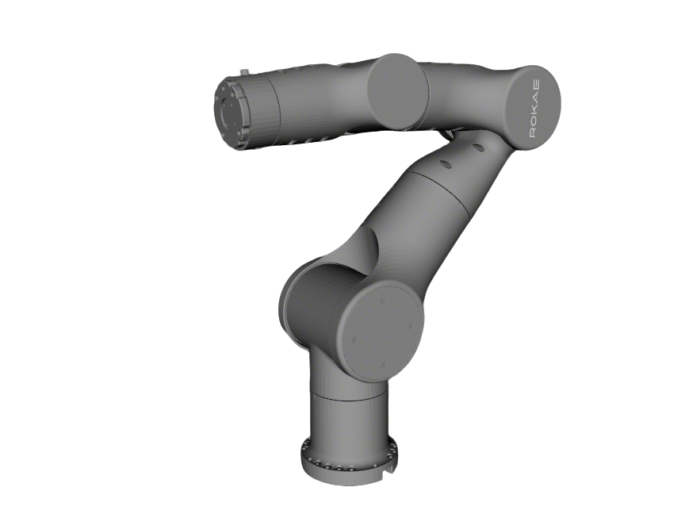
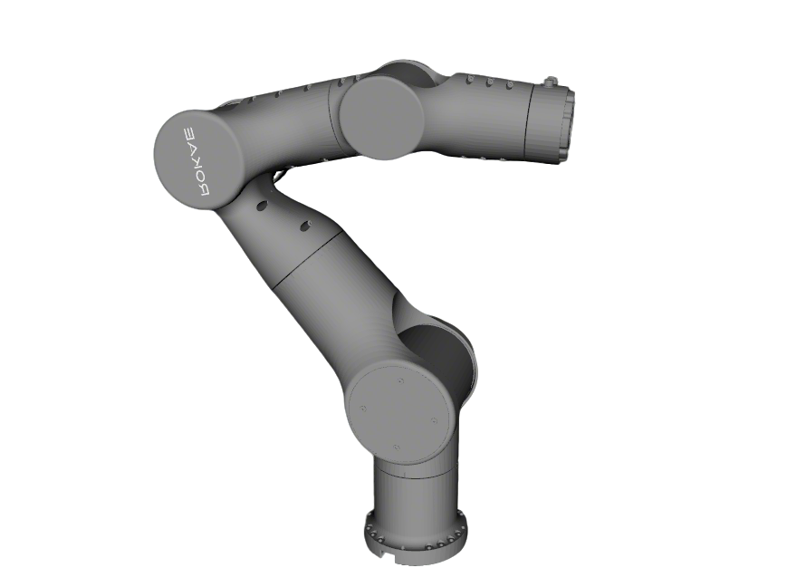

# Rokae AR5-SRS Description

This package contains the description files for the Rokae AR5 manipulator in SRS configuration.

Supported `type` values (see `xacro/robot.xacro`): `left`, `right`, `dual`, `left_rg75`, `right_rg75`, `dual_rg75`.

## 1. Build

```bash
cd ~/ros2_ws
colcon build --packages-up-to ar5_srs_description --symlink-install
```

## 2. Visualize the robot

### 2.1 SRS arm without end effector

* Left arm
    ```bash
    source ~/ros2_ws/install/setup.bash
    ros2 launch robot_common_launch manipulator.launch.py robot:=ar5_srs type:=left collider:=simple
    ```
  
* Right arm
    ```bash
    source ~/ros2_ws/install/setup.bash
    ros2 launch robot_common_launch manipulator.launch.py robot:=ar5_srs type:=right collider:=simple
    ```
  
* Dual arms
    ```bash
    source ~/ros2_ws/install/setup.bash
    ros2 launch robot_common_launch manipulator.launch.py robot:=ar5_srs type:=dual collider:=simple
    ```

### 2.2 SRS arm with Jodell RG75

* Left arm
    ```bash
    source ~/ros2_ws/install/setup.bash
    ros2 launch robot_common_launch manipulator.launch.py robot:=ar5_srs type:=left_rg75 collider:=simple
    ```
* Right arm
    ```bash
    source ~/ros2_ws/install/setup.bash
    ros2 launch robot_common_launch manipulator.launch.py robot:=ar5_srs type:=right_rg75 collider:=simple
    ```
* Dual arms
    ```bash
    source ~/ros2_ws/install/setup.bash
    ros2 launch robot_common_launch manipulator.launch.py robot:=ar5_srs type:=dual_rg75 collider:=simple
    ```

## 3. OCS2 Demo

### 3.1 Official OCS2 mobile manipulator demo

* Left arm
  ```bash
  source ~/ros2_ws/install/setup.bash
  ros2 launch robot_common_launch manipulator_ocs2.launch.py robot_name:=ar5_srs type:=left
  ```
* Right arm
  ```bash
  source ~/ros2_ws/install/setup.bash
  ros2 launch robot_common_launch manipulator_ocs2.launch.py robot_name:=ar5_srs type:=right
  ```

### 3.2 Mock components

* Left arm
  ```bash
  source ~/ros2_ws/install/setup.bash
  ros2 launch ocs2_arm_controller demo.launch.py robot:=ar5_srs type:=left
  ```
* Right arm
  ```bash
  source ~/ros2_ws/install/setup.bash
  ros2 launch ocs2_arm_controller demo.launch.py robot:=ar5_srs type:=right
  ```
* Dual arms
  ```bash
  source ~/ros2_ws/install/setup.bash
  ros2 launch ocs2_arm_controller demo.launch.py robot:=ar5_srs type:=dual
  ```
* Left arm with RG75
  ```bash
  source ~/ros2_ws/install/setup.bash
  ros2 launch ocs2_arm_controller demo.launch.py robot:=ar5_srs type:=left_rg75
  ```
* Right arm with RG75
  ```bash
  source ~/ros2_ws/install/setup.bash
  ros2 launch ocs2_arm_controller demo.launch.py robot:=ar5_srs type:=right_rg75
  ```
* Dual arms with RG75
  ```bash
  source ~/ros2_ws/install/setup.bash
  ros2 launch ocs2_arm_controller demo.launch.py robot:=ar5_srs type:=dual_rg75
  ```

### 3.3 Gazebo simulation

* Left arm
  ```bash
  source ~/ros2_ws/install/setup.bash
  ros2 launch ocs2_arm_controller demo.launch.py robot:=ar5_srs hardware:=gz type:=left
  ```
* Right arm
  ```bash
  source ~/ros2_ws/install/setup.bash
  ros2 launch ocs2_arm_controller demo.launch.py robot:=ar5_srs hardware:=gz type:=right
  ```

### 3.4 Real robot deploy

* Build command

```bash
cd ~/ros2_ws
colcon build --packages-up-to rokae_ros2_control --symlink-install
```

#### 3.4.1 Arm without end effector

* Left arm
  ```bash
  source ~/ros2_ws/install/setup.bash
  ros2 launch ocs2_arm_controller demo.launch.py robot:=ar5_srs hardware:=real type:=left
  ```
* Right arm
  ```bash
  source ~/ros2_ws/install/setup.bash
  ros2 launch ocs2_arm_controller demo.launch.py robot:=ar5_srs hardware:=real type:=right
  ```
* Dual arms
  ```bash
  source ~/ros2_ws/install/setup.bash
  ros2 launch ocs2_arm_controller demo.launch.py robot:=ar5_srs hardware:=real type:=dual
  ```

#### 3.4.2 Arm with Jodell RG75

* Left arm
  ```bash
  source ~/ros2_ws/install/setup.bash
  ros2 launch ocs2_arm_controller demo.launch.py robot:=ar5_srs hardware:=real type:=left_rg75
  ```
* Right arm
  ```bash
  source ~/ros2_ws/install/setup.bash
  ros2 launch ocs2_arm_controller demo.launch.py robot:=ar5_srs hardware:=real type:=right_rg75
  ```
* Dual arms
  ```bash
  source ~/ros2_ws/install/setup.bash
  ros2 launch ocs2_arm_controller demo.launch.py robot:=ar5_srs hardware:=real type:=dual_rg75
  ```
